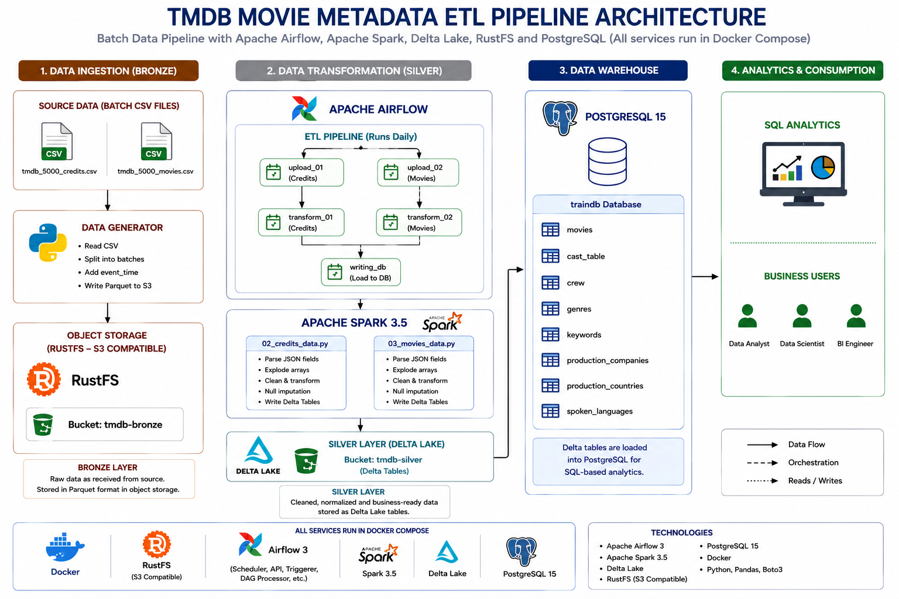
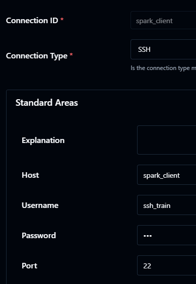
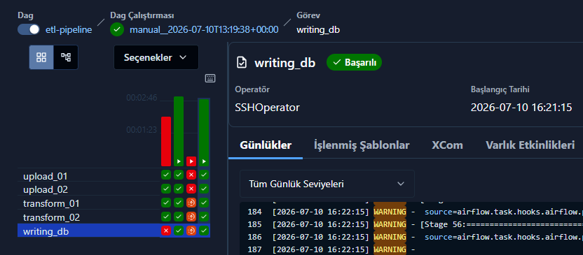
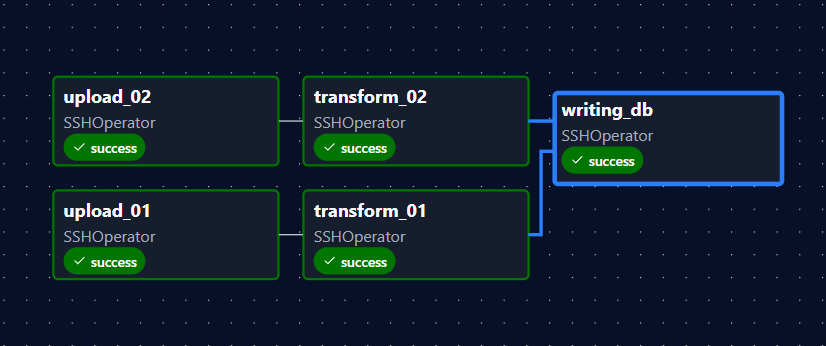

# TMDB Streaming ETL Pipeline

This project implements a batch ETL pipeline for the TMDB Movie Metadata dataset using Apache Airflow, Apache Spark, Delta Lake, RustFS (S3-compatible object storage), and PostgreSQL. Raw movie and credits datasets are periodically ingested into the Bronze layer, transformed into normalized Delta tables in the Silver layer, and finally loaded into PostgreSQL for SQL-based analytics.

## Project Architecture



## Project Structure

```text
airflow3/
├── config/
│   ├── certs/
│   │   ├── airflow.crt
│   │   └── airflow.key
│   └── airflow.cfg
│
├── dags/
│   └── etl-pipeline.py
│
├── etl/
│   ├── raw_data/
│   │   ├── tmdb_5000_credits.csv
│   │   └── tmdb_5000_movies.csv
│   │
│   ├── 01_dataframe_to_s3.py
│   ├── 02_credits_data.py
│   ├── 03_movies_data.py
│   ├── 04_load_to_postgres.py
│   └── all_conn
│
├── .env
├── docker-compose.yaml
├── Dockerfile
├── Dockerfile.spark
└── requirements.txt
```

- The `etl` directory is mounted into the `spark_client` container.

## Container Setups and Configurations

- Setup and starting containers:

```bash
docker-compose up --build -d
```
- SSL/TLS Certificate creation:

```bash
mkdir -p ./config/certs
openssl req -x509 -nodes -days 365 -newkey rsa:2048 \
  -keyout ./config/certs/airflow.key \
  -out    ./config/certs/airflow.crt \
  -subj "/CN=localhost" \
  -addext "subjectAltName=DNS:localhost,DNS:airflow-apiserver,IP:127.0.0.1"
chmod 644 ./config/certs/airflow.crt
chmod 640 ./config/certs/airflow.key
```

### Create Airflow Connection

- `spark_client` container connection:



### Create Database and User

```bash
docker exec -it postgres psql -U airflow

CREATE DATABASE traindb;

CREATE ROLE train
LOGIN
PASSWORD '<YOUR_PASSWORD>';

GRANT ALL PRIVILEGES ON DATABASE traindb TO train;

\c traindb

GRANT USAGE, CREATE ON SCHEMA public TO train;
```

## Results

- Trigger `etl-pipeline.py` on https://localhost:8080



- Graph of pipeline:



- Example Queries:

```sql
select ct.movie_id, ct.title, ct."character", ct."name", m.budget, m.revenue 
from cast_table ct 
join movies m 
on ct.movie_id = m.movie_id 
where name='Tom Cruise'
order by m.revenue desc
limit 10; 
--------------------------------------------------
select g.movie_id, m.title , g.name, m.revenue
from genres g 
join movies m
on g.movie_id = m.movie_id 
order by m.revenue desc
limit 10;
--------------------------------------------------
select movie_id, title, budget, release_date, revenue
from movies
order by revenue desc
limit 10;
---------------------------------------------------
select ct.title, ct."character", ct."name"
from cast_table ct
where ct.name like 'Ahmet%'
---------------------------------------------------
select * from crew
where name like 'Ahmet%'
limit 10;
```

### Technologies

- Apache Airflow 3
- Apache Spark 3.5
- Delta Lake
- RustFS (S3-compatible Object Storage)
- PostgreSQL 15
- Docker
- Python
- Pandas
- Boto3

### Data Source

https://github.com/erkansirin78/datasets/raw/master/tmdb_5000_movies_and_credits.zip